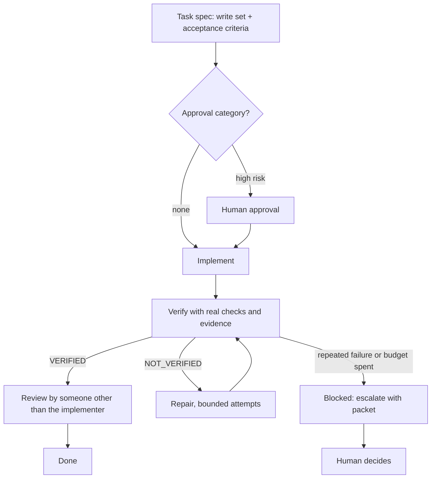

# Agentic Development Starter

**A repo-native operating layer for AI-assisted software development.** Instructions, rules, roles, playbooks, and validation that live in your repository — so every agent, every session, and every teammate works the same way and leaves a trace.

[](https://github.com/psyk01337/Agentic-Development-Starter/actions/workflows/validation.yml)
[](https://github.com/psyk01337/Agentic-Development-Starter/actions/workflows/skill-contract-tests.yml)


> The starter is a workflow layer, not an agent runtime. It does not run anything for you — it makes what runs accountable.

---

## The problem

An AI agent will happily refactor your architecture at 2am because you asked it to fix a typo. Not from malice: from having no stake in your rules, no memory of what you decided last week, and no reason to stop at the boundary you had in mind.

Telling it to be careful does not scale. There is nowhere to put the instruction, no way to check it was followed, and no record that it mattered.

This repository is where those things live:

| What usually goes wrong | What this does instead |
| --- | --- |
| Rules live in someone's chat history | Rules are files, loaded by scope, versioned in git |
| "I tested it" with nothing behind it | Checks are commands, and results are reported |
| The agent fixes things forever | The repair loop is bounded and escalates |
| Decisions vanish after a session | ADRs, changelogs, and handoff contracts |
| Every agent behaves differently | One catalog of roles with declared tool access |

---

## Quick start

```bash
git clone https://github.com/psyk01337/Agentic-Development-Starter.git my-app
cd my-app
rm -rf .git && git init
```

Then open it in VS Code and, in agent mode:

```text
Use route-project-inputs. I dropped my planning documents in docs/inputs/.
```

No documents yet? Run `initialize-new-project` with your stack, or go straight to `build-feature` for the first slice. The full walkthrough is in [QUICKSTART.md](QUICKSTART.md).

Validating the governance layer takes one command:

```bash
bash .github/scripts/check-starter-workflow.sh
```

```powershell
pwsh -NoProfile -File .github/scripts/check-starter-workflow.ps1
```

---

## What you get

| Layer | Count | What it is |
| --- | --- | --- |
| **Instructions** | 33 | Rules loaded by path scope. Three load on every request; the rest only when a matching file is open |
| **Skills** | 34 | Bounded playbooks — review, threat modeling, migrations, dependency upgrades, refactoring, domain debugging |
| **Agents** | 12 | Specialist roles with declared tool access, escalation rules, and a handoff contract |
| **Prompts** | 23 | One-off workflows: feature delivery, docs ingestion, bug fixing, release notes, CI triage |
| **Evals** | 13 | Golden tasks with checklists, so "did the agent behave" is gradable rather than felt |
| **Guardrails** | 11 checks | Manifest, skills, agents, prompts, hooks, MCP posture, markdown, evals, engine — in Bash **and** PowerShell |

Every asset is registered in [`.github/starter-modules.json`](.github/starter-modules.json) — 39 modules across core, optional, and overlay. Nothing ships enabled that you did not choose, and a validator fails if an asset exists without being registered.

---

## How it works

Work moves through a loop with hard boundaries, so a run either produces evidence or stops with a reason.



The loop is enforced by [`agentic_engine.py`](.github/scripts/agentic_engine.py), a deterministic state machine with 62 self-tests. It refuses `VERIFIED` while any check fails, rejects a write outside the declared set, refuses a reviewer who implemented the work, and stops on an identical failure signature rather than retrying forever.

Try it without touching a thing:

```bash
python .github/scripts/agentic_engine.py selftest
```

Requires Python 3.9+. Read the stage contract in [agentic-engine.md](docs/runbooks/agentic-engine.md).

---

## Choosing the right surface

Most agent setups fail by putting everything in one giant instruction file. This one makes you pick the smallest thing that fits.

| You have | Use | It lives in |
| --- | --- | --- |
| A rule that must apply every session | **Instruction** | `.github/instructions/` |
| A repeatable one-off task | **Prompt** | `.github/prompts/` |
| A bounded, format-sensitive playbook | **Skill** | `.github/skills/` |
| A recurring role that needs judgment | **Agent** | `.github/agents/` |
| A durable decision with tradeoffs | **ADR** | [docs/adr/](docs/adr/) |
| An operational procedure | **Runbook** | [docs/runbooks/](docs/runbooks/) |
| A shell command that should be blocked | **Hook rule** | [`.github/hooks/policy-rules.tsv`](.github/hooks/policy-rules.tsv) |

Promote upward only when a pattern earns it: a prompt that keeps being reused becomes a skill, a skill that keeps needing judgment becomes an agent, and a rule that must never be forgotten becomes an instruction.

---

## Adoption modes

Start at the smallest mode that works. Every mode is additive.

| Mode | For | Includes |
| --- | --- | --- |
| **Minimal** | A small repo, or a first rollout | Core instructions, security defaults, memory policy, manifest, validation, changelogs |
| **Team** | Multiple contributors or agents | Agents, skills, prompts, hook policy, CI validation, runbooks |
| **Advanced** | Stronger governance | Approval-gated handoffs, MCP templates after review, eval harness, tool-surface matrix |
| **Enterprise** | Organization-level policy | Org overlays, private shared skills, centralized review, audit requirements |

MCP servers, durable memory, and high-risk automation stay **disabled by default** in every mode until someone reviews the risk. See [starter-adoption.md](docs/runbooks/starter-adoption.md) for how much to take.

---

## Validation is the point

A guardrail nobody checks is a comment. Eleven contracts run on push and pull request, and every one exists in both Bash and PowerShell so Windows and CI agree.

| Check | Catches |
| --- | --- |
| `check-starter-manifest` | Unregistered assets, missing files, invalid versions |
| `check-starter-skills` | Malformed skill contracts |
| `check-agent-contracts` | Missing handoff, escalation, or output sections |
| `check-prompt-contracts` | Missing safety boundaries or expected output |
| `check-hook-policy` | Dangerous commands that would slip through |
| `check-supervisor-orchestration` | Delegation depth violations, using mutated fixtures |
| `check-mcp-posture` | Servers enabled without review |
| `check-markdown-quality` | Trailing whitespace, broken relative links |
| `check-evals` | Golden tasks without a checklist |
| `check-agentic-engine` | Policy drift, engine regressions |
| `check-approval-gated-orchestration` | Approval envelopes that skip the gate |
| `check-starter-workflow` | Runs all of the above |

<details>
<summary><strong>Running individual checks, and the Makefile shortcuts</strong></summary>

```bash
bash .github/scripts/check-starter-manifest.sh
bash .github/scripts/check-starter-skills.sh
bash .github/scripts/check-agent-contracts.sh
bash .github/scripts/check-prompt-contracts.sh
bash .github/scripts/check-hook-policy.sh
bash .github/scripts/check-markdown-quality.sh
bash .github/scripts/check-evals.sh
bash .github/scripts/check-agentic-engine.sh
python .github/scripts/agentic_engine.py selftest
```

`make validate` runs the Bash umbrella, `make validate-ps` the PowerShell one, and `make check-all` every individual check. CI runs [validation.yml](.github/workflows/validation.yml) and [skill-contract-tests.yml](.github/workflows/skill-contract-tests.yml), so a local pass and a green PR check assert the same thing.

</details>

---

## Where things live

```text
AGENTS.md                  cross-agent entry point
.github/
  copilot-instructions.md  always-on baseline
  agent-catalog.md         roles, handoff contract, delegation triggers
  instructions/            rules, loaded by path scope
  prompts/  skills/        workflows and playbooks
  agents/                  specialist definitions
  hooks/                   command guardrails
  scripts/                 validation, in Bash and PowerShell
  starter-modules.json     what ships enabled (39 modules)
docs/
  adr/                     durable decisions with tradeoffs
  runbooks/                operational guidance
  inputs.md                source-document provenance and routing log
evals/                     golden tasks and checklists
app/                       your application lives here
CHANGELOG.md               what the code does
DOC-CHANGELOG.md           what the documentation says
```

---

## What this is not

Being clear about the edges saves everyone a bad week.

- **Not a runtime.** No scheduler, no tool broker, no autonomous execution platform. Hermes is a stateful runtime and stays an optional overlay, not a dependency.
- **Not an app template.** No framework opinions about your frontend. It governs *how* code gets built, not what you build.
- **Not enforcement.** Instructions are injected as context; a model can ignore them. Only hooks, validators, and CI actually block anything. Everything else is a contract.
- **Not autonomous.** It bounds an agent's work and makes it prove it. It does not hand over the decision.

If those are what you need, this is the wrong repository and it is better to know now.

---

## Start here

If you want to understand the repo rather than just use it, read these six in order:

1. [`AGENTS.md`](AGENTS.md) — the cross-agent entry point.
2. [`.github/copilot-instructions.md`](.github/copilot-instructions.md) — the always-on baseline.
3. [`agent-catalog.md`](.github/agent-catalog.md) — roles, handoff contract, delegation triggers.
4. [`agentic-dev.md`](docs/runbooks/agentic-dev.md) — the daily rhythm.
5. [`starter-adoption.md`](docs/runbooks/starter-adoption.md) — how much to adopt.
6. [`starter-composition.md`](docs/runbooks/starter-composition.md) — what each module is for.

---

## Extending it

Add the file where the surface table says it belongs, then register it. Registration is not optional — a validator fails on an unregistered asset, which is what stops the repo drifting into an undocumented pile.

<details>
<summary><strong>Checklist for adding a prompt, skill, agent, or instruction</strong></summary>

**Any new asset**

1. Put it in the right surface directory.
2. Register it in [`.github/starter-modules.json`](.github/starter-modules.json), or `check-starter-manifest` fails.
3. Update `CHANGELOG.md` and `DOC-CHANGELOG.md` in the same change.
4. Run the umbrella check.

**A skill** — `SKILL.md` frontmatter needs a lowercase hyphenated `name` and a `description`.

**A prompt** — state the context to inspect first, deliverables, safety boundaries, a destructive-change stop rule, and the expected output.

**An agent** — the supervisor validator requires five coordinated registrations, and missing any one is a hard failure:

1. a `tools` frontmatter list in the agent file itself
2. an entry in [`.github/agent-catalog.md`](.github/agent-catalog.md)
3. `agentRoleHints` **and** `agentCapabilityMatrix` in [`.github/roles/tool-access.json`](.github/roles/tool-access.json)
4. `specialistAllowList` in [`.github/roles/orchestration-policy.json`](.github/roles/orchestration-policy.json)
5. the agent enum in [`.github/schema/delegation-plan.schema.json`](.github/schema/delegation-plan.schema.json) and [`.github/schema/delegation-result.schema.json`](.github/schema/delegation-result.schema.json), which must match the allow-list exactly

Also include a `## Handoff Memory Contract` section. An agent that skips the allow-list is allowed, but it still needs a matrix entry and a role hint, and it cannot be delegated to.

</details>

### Mistakes that cost the most

- Copying the starter's example docs into a project instead of pointing at your real source-of-truth docs.
- Enabling an overlay before the code path exists — game overlays in a repo with no `app/game/`, for example.
- Letting a prompt quietly become an always-on rule. Durable standards belong in instructions.
- Editing policy inside a hook script instead of [`.github/hooks/policy-rules.tsv`](.github/hooks/policy-rules.tsv).
- Trusting chat memory for a decision that belongs in an ADR or runbook.
- Skipping the changelog because the change "was small".
- Improving the starter while building the app. Use `improve-repo` on real friction, not on tidiness.

## Go deeper

| Read | For |
| --- | --- |
| [QUICKSTART.md](QUICKSTART.md) | First feature in about ten minutes |
| [AGENTS.md](AGENTS.md) | How other harnesses find this repo's rules |
| [agent-catalog.md](.github/agent-catalog.md) | Roles, handoffs, delegation triggers |
| [docs/runbooks/INDEX.md](docs/runbooks/INDEX.md) | Guidance by task |
| [agentic-dev.md](docs/runbooks/agentic-dev.md) | The daily loop |
| [starter-composition.md](docs/runbooks/starter-composition.md) | What loads when, and what it costs |
| [adopting-existing-github.md](docs/runbooks/adopting-existing-github.md) | Merging into an existing repo |
| [app/README.md](app/README.md) | Where your application goes, and how to verify it |
| [TROUBLESHOOTING.md](TROUBLESHOOTING.md) | When a check or a run is unhappy |

---

## Roadmap

- Machine-readable eval scoring metadata, so grading is not a manual read.
- Fixture repositories for controlled golden tasks.
- Platform adapters beyond VS Code agent mode.
- Deeper schema validation for prompt and agent metadata.
- Expand policy fixtures as real false positives and bypasses surface.

Contributions that come with a failing test and a validator get reviewed first.

---

## Security defaults

No secrets in repo files, examples, logs, prompts, or memory. No MCP servers, durable memory providers, or dangerous shell automation enabled by default. Hook policy blocks destructive deletion, hard resets, force pushes, remote shell execution, secret-like writes, and plain-HTTP package registries. CI runs the same contracts locally and on every pull request.
